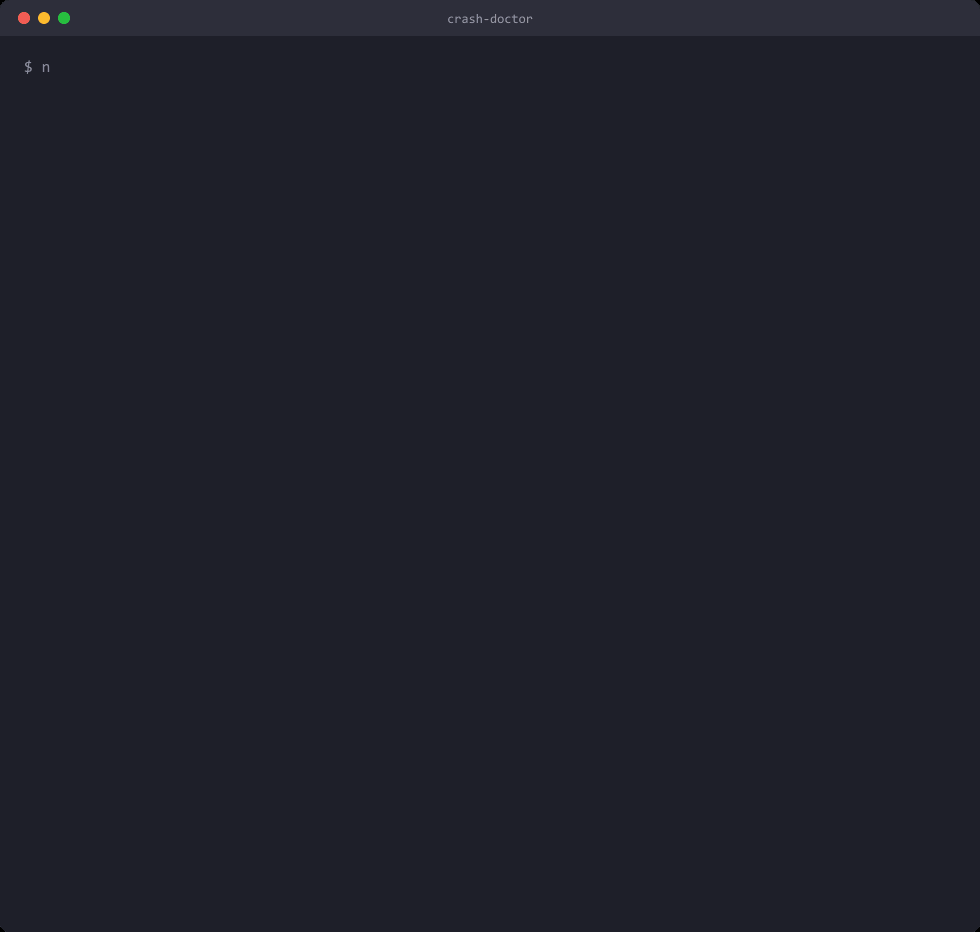
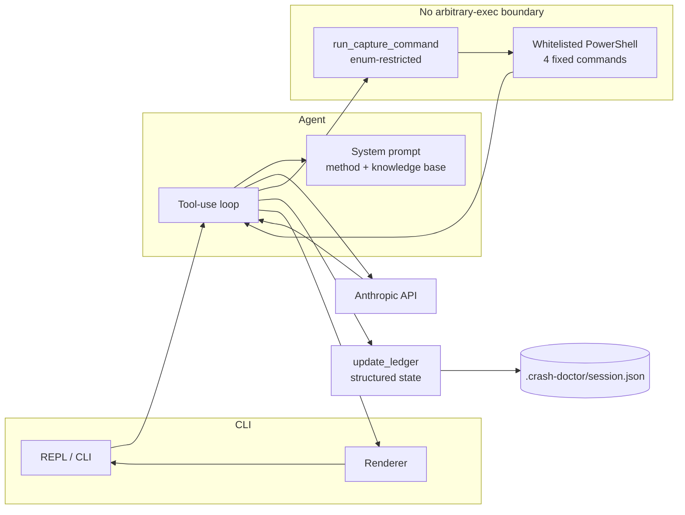

# Crash Doctor

[](https://github.com/gergerer/crash-doctor/actions/workflows/ci.yml)


An AI-assisted CLI for Windows crash triage (BSODs, black-screen crashes,
unexpected reboots). It runs a disciplined, evidence-driven diagnostic loop —
**CAPTURE → DECODE → HYPOTHESISE → TEST → UPDATE → RESOLVE** — instead of
handing you a generic troubleshooting checklist, and it maintains a live
evidence ledger until a root cause is confirmed.



_A representative session assembled from real runs against the live API, rendered as a terminal recording._

<details>
<summary>Same session as text</summary>

```
$ npm run dev

Starting a new crash-triage session. Describe what's happening
(symptom, frequency, load vs idle, timestamps).

> My PC has been crashing randomly, black screen, a few times
  over the last two weeks.

  -> running capture command: recent_bugcheck_events
  -> running capture command: stopcode_wer_events
  -> running capture command: whea_hardware_events

CAPTURE: all four queries came back empty - no bugcheck events, no WHEA
hardware errors, no minidump folder, no WER stopcode entries.

That's meaningful: Windows has no record of a kernel bugcheck at all. A
black-screen crash with zero OS trace points toward a hard hang or
power-loss event, not a handled driver exception.

HYPOTHESISE:
  1. Hard hang / power-loss (PSU, GPU power delivery, total freeze)
  2. Crash-dump logging disabled or being cleared
  3. WHEA-reported hardware error not yet triggered

TEST: does the PC reboot on its own, or just go black and hang until a
manual hard reset? That single answer splits hypothesis 1 from the rest.

--- Evidence ledger ---
| Suspect                        | Status    | Evidence                     |
|---------------------------------|-----------|-------------------------------|
| OS-logged bugcheck              | Ruled out | zero results across captures |
| Hard hang / power-loss          | Open      | no OS trace despite crashes   |
| Logging disabled (config issue) | Open      | no Minidump folder present    |
------------------------

> /exit

Session saved to .crash-doctor/session.json. Run with --resume to continue.
```

</details>

## Origin story

This started as a set of [Claude Code](https://docs.claude.com/en/docs/claude-code)
custom instructions — a `CLAUDE.md` method file, a domain knowledge base, and
a permission whitelist — that turned Claude Code itself into a crash-triage
assistant. The original files are preserved in
[`docs/original-claude-code-project/`](docs/original-claude-code-project/).

This repo is that same method rebuilt as a **standalone application**: real
TypeScript, calling the Anthropic API directly via
[`@anthropic-ai/sdk`](https://github.com/anthropics/anthropic-sdk-typescript),
with its own tests and its own safety boundary — no dependency on Claude Code
being installed.

## Architecture



The model has exactly two tools: `run_capture_command`, restricted to an enum
of four whitelisted, read-only PowerShell queries, and `update_ledger`, a
structured mutation of the evidence table. **There is no tool whose input is
an arbitrary string passed to a shell.** DECODE tooling (WinDbg), TEST-phase
actions (driver updates, BIOS/XMP changes, MemTest86), and any fix are
presented as text for you to run yourself and paste the output back — the
model has no code path available to execute them, structurally, not just by
prompt instruction.

## Setup

1. Install [Node.js](https://nodejs.org/) 18 or later (or via
   [nvm-windows](https://github.com/coreybutler/nvm-windows)).
2. `npm install`
3. `cp .env.example .env` and add your key from
   [console.anthropic.com](https://console.anthropic.com/settings/keys).
4. `npm run dev` (or `npm run build && npm start`)

Run the test suite with `npm test` — it needs no API key and no Windows
machine; the executor tests mock `child_process` directly.

## Usage

```
npx tsx src/index.ts [options]

Options:
  -r, --resume         resume the last session in .crash-doctor/session.json
  -m, --model <model>  Claude model to use (default: claude-sonnet-5)
```

Describe your symptom to start. Type `/exit` to quit; your ledger and
transcript are saved after every turn, so `--resume` picks up where you left
off — useful since crash triage often spans a reboot (BIOS changes,
MemTest86) or a multi-day observation window.

## Design decisions

- **No arbitrary-exec tool exists.** This is a stronger claim than "the
  system prompt says not to" — it's enforced by the tool schema
  (`src/tools/captureTool.ts`) having no free-text command parameter, and by
  the executor (`src/commands/captureExecutor.ts`) mapping a symbolic id to a
  **fixed** `execFile` argv array, never a string built from model output.
- **The evidence ledger is structured tool-call state, not parsed prose.**
  `update_ledger` is a typed tool call; the CLI renders the markdown table
  itself (`Ledger.toMarkdownTable()`). The model can't drift out of table
  format, typo a status, or silently drop a row.
- **The knowledge base is embedded, not loaded at runtime.** It's ~5KB,
  single-domain, and ships with the code — embedding it as typed TS data
  (`src/prompt/knowledgeBase.ts`) makes it directly unit-testable and avoids
  a file-path failure mode for zero benefit in a v1 with one domain.
- **The system prompt is split into a cached static block and an uncached
  dynamic block.** The method + knowledge base is byte-identical every turn
  and carries `cache_control: { type: "ephemeral" }`; the evidence ledger
  changes every turn and sits after the cache breakpoint uncached — merging
  them would invalidate the cache on every single message.
- **Sessions persist from v1, not as a later add-on.** Crash triage
  inherently spans reboots and multi-day observation windows (see the
  knowledge base's own RESOLVE guidance) — a tool that forgets everything
  when the terminal closes would be hostile to its own use case.

## Extending later

- **More capture commands**: add an id to `CAPTURE_COMMANDS`
  (`src/tools/captureTool.ts`) and a matching entry in `CAPTURE_COMMANDS_KB`
  (`src/prompt/knowledgeBase.ts`) — the executor, the tool schema, and the
  system prompt all read from the same source, so there's one place to keep
  in sync.
- **Higher autonomy for reversible TEST commands** (e.g. toggling XMP): would
  need a new, similarly enum-restricted tool with its own explicit whitelist
  — the "no arbitrary exec" boundary should hold even as autonomy grows.
- **Handoff export**: a `crash-doctor ledger export` command formatting the
  persisted ledger as a ticket/RMA packet/postmortem.
- **Multi-session support**: `--session <name>` to keep more than one
  machine's triage history side by side.
- **Other domains** (Linux panics, app crashes): if this ever generalizes
  beyond Windows crashes, that's the point where `knowledgeBase.ts` becomes a
  `get_knowledge_base(domain)` tool instead of an inlined constant.

## License

MIT — see [LICENSE](LICENSE).
